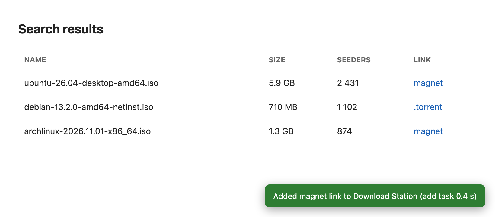

# Send to Download Station

A browser extension for Brave / Chrome that sends magnet and `.torrent` links straight to
[Synology Download Station](https://www.synology.com/dsm/packages/DownloadStation), so you
don't have to copy and paste them into DSM.

## What it does

- **Left-click** a `magnet:` link, a `.torrent` link, or a [Jackett](https://github.com/Jackett/Jackett)
  download link: it is added to Download Station instead of being opened. A toast in the
  bottom-right corner shows the result.
- **Alt-click** a link to get the browser's normal behaviour.
- **Right-click** any link and choose **Send link to Download Station**.
- `.torrent` files are downloaded by the browser and uploaded to the NAS, so links that
  need your browser's login cookies work too.
- The toolbar icon shows the connection state: grey (not connected), green (last request
  worked), red (last request failed — hover for the error).

## Install

The extension is not in the Chrome Web Store; load it unpacked:

1. Download or clone this repository.
2. Open `brave://extensions` (or `chrome://extensions`) and enable **Developer mode**.
3. Click **Load unpacked** and select the repository folder.

## Set up

The settings page opens after installation (later: click the toolbar icon).

1. **DSM address** — the address you use to open DSM, including the port
   (`5000` for http, `5001` for https).
2. **Username / Password** — a DSM account that is allowed to use Download Station.
3. **Destination folder** (optional) — a shared-folder path without leading slash, for
   example `downloads/torrents`. Leave empty to use Download Station's default.
4. Click **Save & test**.

Use a dedicated, restricted DSM account rather than your own: see
[A dedicated DSM user](#a-dedicated-dsm-user).

If the account uses 2-factor authentication, you are asked for a code once. The browser is
then registered in DSM as a trusted device named "Brave - Send to Download Station".

**Disconnect** logs the extension out and deletes the saved password and trusted-device
token from the browser.

## A dedicated DSM user

The extension stores the password unencrypted in the browser profile, so give it an account
that can do nothing except add downloads. Create it in **Control Panel > User & Group**:

1. **User Groups**: leave it in `users` only, never in `administrators`.
2. **Applications**: allow **Download Station** and deny everything else, **DSM** included.
   The extension logs in with a Download Station session, so it works without DSM access.
3. **Permissions**: Read/Write on the destination folder, No Access everywhere else. Check
   the **Preview** column, not only your ticks: every user belongs to `users`, and whatever
   that group grants (often Read Only on `docker`, custom rules on Synology Drive's folder)
   applies to this user as well. Tick **No Access** on those rows to override it.
4. **Destination**: give downloads a shared folder of their own (for example `Incoming`,
   with Read/Write for this user and for you). The user cannot write into another user's
   home folder unless it can see every home folder.
5. **Default destination**: the user needs its own default folder in Download Station,
   even though the extension sends one. Without it, magnet links are accepted but stay on
   "Waiting" forever. Allow DSM for a moment, log in as the
   user, set **Download Station > Settings > Location** (BitTorrent and eMule), log out
   and deny DSM again.

Tasks it adds show up in Download Station for every administrator, with the dedicated user
as owner, so you can keep managing them from your own account.

## Good to know

- The extension needs access to all sites: it has to see link clicks on any page and
  download `.torrent` files from any host. It only talks to the sites you click links on
  and to your NAS.
- Prefer the `.torrent` link over the magnet link for Internet Archive results. Their
  torrents download mostly from archive.org's own servers, and a magnet link does not carry
  that address, so it may never find a source.
- The first request after the NAS has been idle can take a few seconds while DSM wakes up.
- Requires DSM 7 with the Download Station package installed.

## Licence

[MIT](LICENSE)
