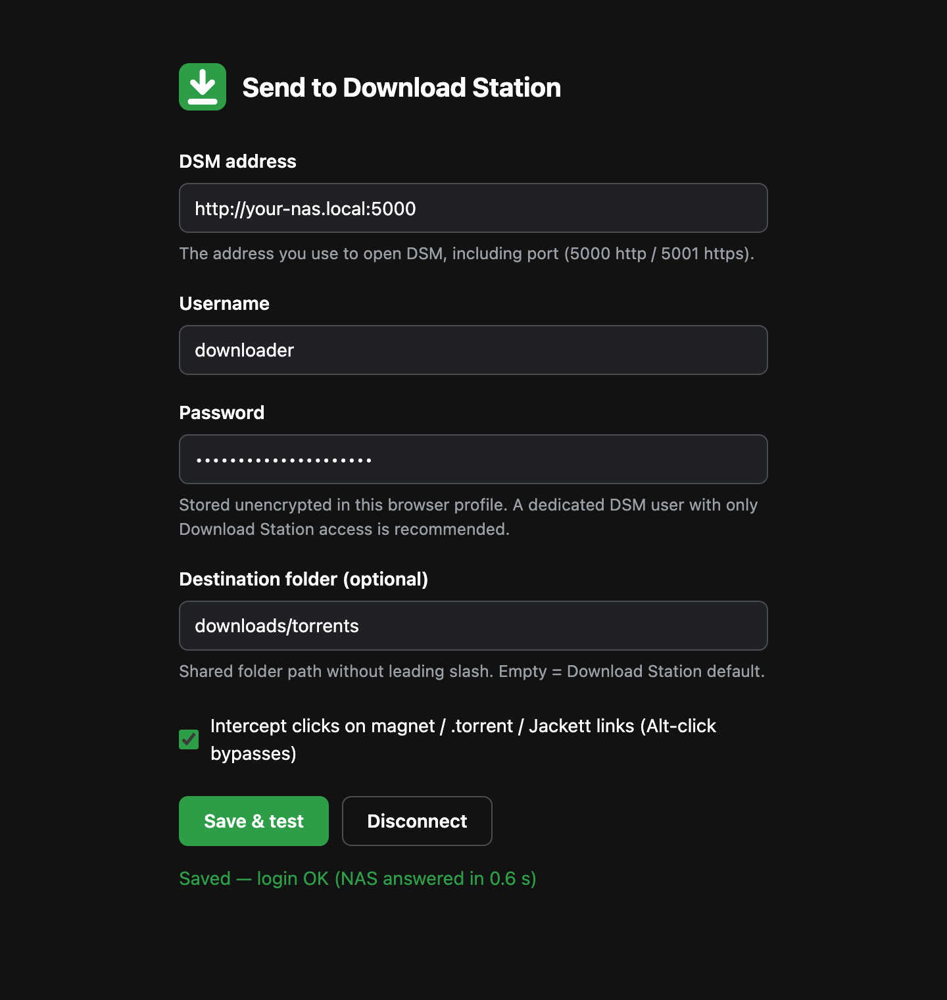
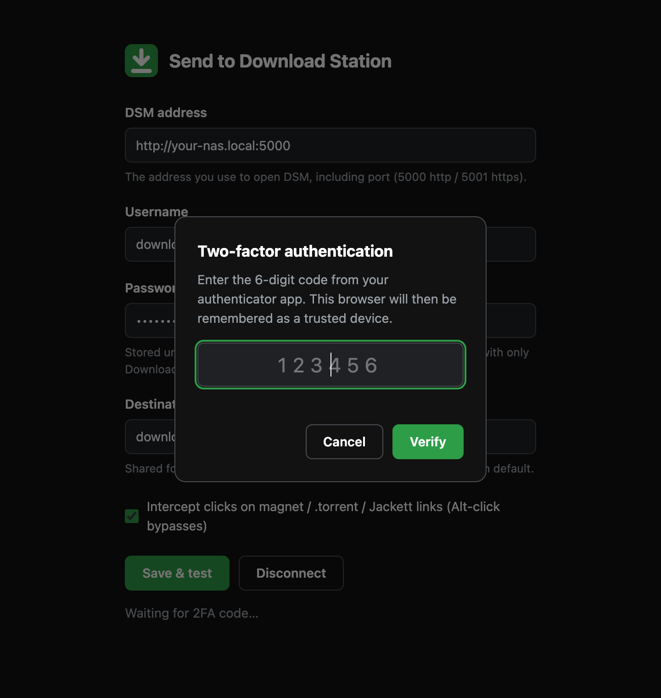

# Send to Download Station

A browser extension for Brave / Chrome that sends magnet and `.torrent` links straight to
[Synology Download Station](https://www.synology.com/dsm/packages/DownloadStation), so you
don't have to copy and paste them into DSM.

## What it does

- **Left-click** a `magnet:` link, a `.torrent` link, or a [Jackett](https://github.com/Jackett/Jackett)
  download link: it is added to Download Station instead of being opened. A toast in the
  bottom-right corner shows the result.
- **Alt-click** a link to get the browser's normal behaviour.
- **Right-click** any link and choose **Send link to Download Station**.
- `.torrent` files are downloaded by the browser and uploaded to the NAS, so links that
  need your browser's login cookies work too.
- The toolbar icon shows the connection state: grey (not connected), green (last request
  worked), red (last request failed — hover for the error).

## Install

The extension is not in the Chrome Web Store; load it unpacked:

1. Download or clone this repository.
2. Open `brave://extensions` (or `chrome://extensions`) and enable **Developer mode**.
3. Click **Load unpacked** and select the repository folder.

## Set up

The settings page opens after installation (later: click the toolbar icon).

1. **DSM address** — the address you use to open DSM, including the port
   (`5000` for http, `5001` for https).
2. **Username / Password** — a DSM account that is allowed to use Download Station.
3. **Destination folder** (optional) — a shared-folder path without leading slash, for
   example `downloads/torrents`. Leave empty to use Download Station's default.
4. Click **Save & test**.

If the account uses 2-factor authentication, you are asked for a code once. The browser is
then registered in DSM as a trusted device named "Brave - Send to Download Station".

**Disconnect** logs the extension out and deletes the saved password and trusted-device
token from the browser.

## Good to know

- The password is stored unencrypted in the browser profile. Use a dedicated DSM user that
  only has the Download Station permission.
- The extension needs access to all sites: it has to see link clicks on any page and
  download `.torrent` files from any host. It only talks to the sites you click links on
  and to your NAS.
- The first request after the NAS has been idle can take a few seconds while DSM wakes up.
- Requires DSM 7 with the Download Station package installed.
